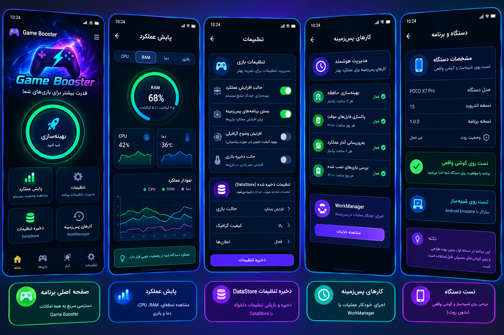

# ⚡ Game Booster — Neon Persian

بواستر بازی **بدون روت** — دو بخش دارد:

1. **اپ اندروید اصلی (Kotlin + Jetpack Compose + MVVM)** — نسخه ۱.۱.۰، ۸ صفحه کامل
2. **نمونه‌ساز تعاملی وب (Next.js)** — شبیه‌سازی کامل اپ با UI نئون فارسی/RTL

---

## 📱 دانلود APK

آخرین APK به‌صورت خودکار ساخته و در بخش [**Releases**](../../releases) منتشر می‌شود:

1. به صفحه [Releases](../../releases) بروید
2. فایل `GameBooster-v1.1.0-debug.apk` را دانلود کنید
3. روی گوشی: تنظیمات ← اجازه «نصب از منابع ناشناس» برای مرورگر/فایل‌منیجر ← نصب

> APK از نوع **debug** است (برای تست). نسخه release-signed بعداً اضافه می‌شود.

## 🏗 اپ اندروید اصلی (android/)

معماری **MVVM** با **Jetpack Compose** (Material3)، تم نئون تاریک/روشن، **فارسی/انگلیسی** با سوئیچ درون‌برنامه‌ای.

### صفحات
| صفحه | قابلیت‌ها |
|---|---|
| 🏠 Home | کارت بازی انتخاب‌شده، RAM زنده، دما/CPU، tiles دسترسی سریع، دکمه BOOST & PLAY، نتیجه آخرین بهینه‌سازی |
| 🎮 Library | جست‌وجوی اپ‌های نصب‌شده (PackageManager)، موردعلاقه (DataStore)، تگ بازی، اجرای یک‌ضرب |
| 🧠 RAM Manager | فشار حافظه، بررسی پیش از اجرا، توقف کارهای پس‌زمینه خود اپ، پاک‌سازی امن کش خود اپ + محافظت کش Shader |
| 🌐 DNS | تست واقعی تأخیر ۱۰ سرور (TCP:53)، بهترین سرور، کپی IP، چیپ‌های DoH/DoT، راهنمای Private DNS |
| 📶 Network | پینگ واقعی ICMP + جیتر + افت بسته + حل DNS، امتیاز کیفیت، پیشنهادهای بهبود |
| 📊 Monitor | تب‌های CPU/رم/دما/تاریخچه تست‌ها |
| ⚙️ Settings | زبان، تم، تنظیمات بوست، کارهای WorkManager (toggle + اجرای فوری)، بازگردانی کامل |
| 📱 Device | مشخصات کامل دستگاه، وضعیت روت، راهنمای سازگاری |

### جریان BOOST (۴ مرحله)
۱) پاک‌سازی حافظه (`killBackgroundProcesses` — بدون اپ‌های سیستمی) → ۲) بررسی شبکه (پینگ واقعی) → ۳) اعمال پروفایل بازی → ۴) اجرای بازی + ثبت تاریخچه

### پشته فنی
- **UI**: Jetpack Compose + Material3 + material-icons-extended
- **معماری**: MVVM — `AppViewModel` با StateFlow + Repository ها
- **تنظیمات**: DataStore Preferences (زبان/تم/سوییچ‌ها/علاقه‌مندی‌ها/پروفایل‌ها/تاریخچه)
- **پس‌زمینه**: WorkManager — پاک‌سازی کش خود اپ (۱۲ ساعت) + بررسی اپ‌ها (۲۴ ساعت) با لاگ اجرا
- **minSdk 26 / targetSdk 34** — AGP 8.5.2 + Kotlin 2.0.21

### بیلد خودکار APK
هر push روی `main`: [`.github/workflows/build-apk.yml`](.github/workflows/build-apk.yml) → artifact + Release جدید

### بیلد محلی (اختیاری)
```bash
cd android
gradle assembleDebug        # یا باز کردن پوشه android در Android Studio
# خروجی: app/build/outputs/apk/debug/app-debug.apk
```

## 🖥 نمونه‌ساز وب (Next.js)

نمونه‌ساز تعاملی کامل با ۸ صفحه — MVVM (Zustand)، دوزبانه FA/EN و تم روشن/تاریک:

```bash
bun install
bun run dev
```



## 🗂 ساختار

```
├── android/            # اپ اصلی اندروید (Kotlin + Compose + MVVM)
│   └── app/src/main/java/com/neon/gamebooster/
│       ├── data/       # Models، Prefs (DataStore)، Repos، WorkManager
│       ├── vm/         # AppViewModel (StateFlows)
│       └── ui/         # Theme، AppRoot، ۸ صفحه، کامپوننت‌ها
├── src/                # نمونه‌ساز وب Next.js
├── .github/workflows/  # بیلد خودکار APK
└── docs/               # تصاویر مستندات
```

## ⚠️ نکته فنی (طراحی بدون روت)

- هیچ اپی نمی‌تواند کش سایر برنامه‌ها را پاک کند یا RAM «اجباری» آزاد کند — فقط **درخواست** توقف فرایندهای پس‌زمینه به سیستم داده می‌شود؛ اپ‌های سیستمی هرگز لمس نمی‌شوند
- کش Shader محافظت می‌شود چون حذفش باعث لگ داخل بازی می‌شود
- تغییر DNS فقط سرعت حل نام را بهتر می‌کند و تضمینی برای کاهش پینگ داخل بازی ندارد (حالت VPN تونل‌شده در نقشه راه نسخه ۲ است)
- کنترل فرکانس CPU/GPU توسط اپ‌های معمولی امکان‌پذیر نیست — برنامه فرکانس را فقط **نمایش** می‌دهد
